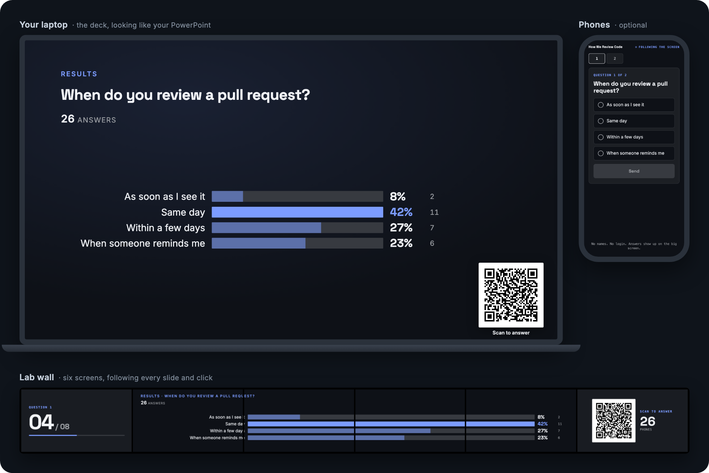
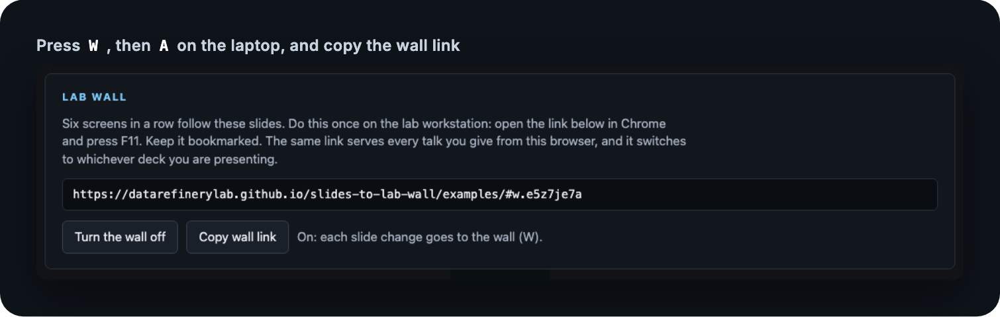
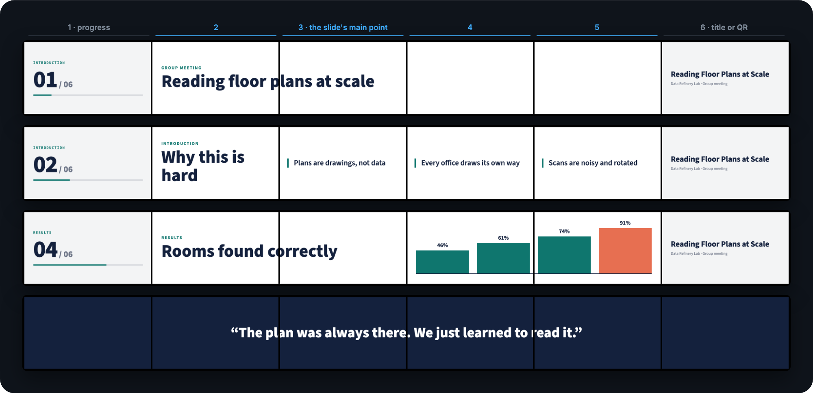
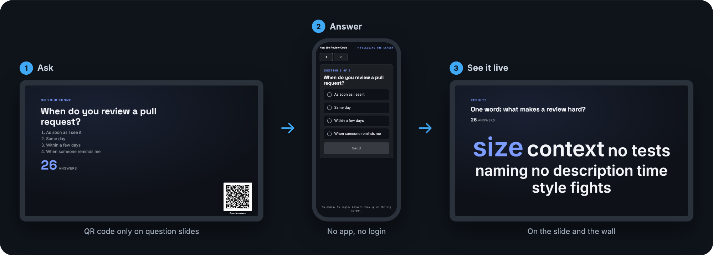

# Slides to lab wall

**Give Claude your slides. Present them on the lab wall.**



A [Claude Code](https://claude.com/claude-code) skill. It turns a PowerPoint, Keynote, PDF or Google Slides file into a web deck that looks like the original and puts it on GitHub Pages. The lab's six screens follow every slide and click.

[**See the live examples →**](https://datarefinerylab.github.io/slides-to-lab-wall/examples/)

---

## 1 · Install

In Claude Code:

```
/plugin marketplace add datarefinerylab/slides-to-lab-wall
```
```
/plugin install slides-to-lab-wall@datarefinerylab
```

You also need `git`, the [GitHub CLI](https://cli.github.com) (signed in with `gh auth login`), Python 3 and Chrome.

## 2 · Ask

> Put `~/Desktop/group-meeting.pptx` on the lab wall.

Claude asks a few quick questions and then does the rest:

| | Default |
|---|---|
| Which file? | the one you named |
| Where on GitHub? | `your-name/slide-decks` |
| Look and transitions? | **same as the original**, or describe changes |
| Audience questions? | **none** |

You get back a link like `your-name.github.io/slide-decks/group-meeting/`. To change something later, just ask.

## 3 · Present

Open your link on the laptop and press **`F`**. Use **`→`** to go forward and **`←`** to go back.

**On the lab workstation, set up once:**



Open the copied link on the workstation in Chrome, press **`F11`** and bookmark it. It works for all your future talks too.

## What the wall shows

Each slide gets its own wide layout for the six screens, in the same style as the deck.



## Audience questions (optional)



Slides without questions stay plain, with no QR code. Press **`Q`** to show the QR code full screen, **`D`** to rehearse with demo answers, and **`A`** → **Export CSV** to save the answers after the talk.

---

<details>
<summary><b>All keys</b></summary>

| Key | |
|---|---|
| `→` `Space` / `←` | next / back |
| number + `Enter` | go to slide |
| `F` | full screen |
| `B` | black screen |
| `W` | wall on / off |
| `A` | setup panel |
| `M` | no transitions |
| `Q` / `D` | big QR code / demo answers |
| `C` (on the wall) | show screen outlines |

</details>

<details>
<summary><b>Something's not working</b></summary>

| | |
|---|---|
| The wall doesn't move | Press `W` on the laptop. Both computers need internet. |
| The wall shows another talk | Someone else is presenting with wall on. They press `W`. |
| Phones can't answer | Present from the GitHub link, not a local file. |
| New laptop | Copy its wall link to the workstation again (`A`). |
| The link doesn't work yet | The first publish can take a few minutes. |

More: [publishing and troubleshooting](skills/slides-to-lab-wall/references/publishing.md)

</details>

<details>
<summary><b>How it works</b></summary>

- Every talk is one HTML page that uses a small shared engine (`labdeck/`, no dependencies).
- The laptop sends the current slide and click to a free message relay ([ntfy.sh](https://ntfy.sh)), and the workstation listens. No server to run, and the two computers don't need to share a network.
- Only slide numbers and anonymous answers are sent. GitHub Pages sites are public, so don't publish confidential slides.
- Docs for the curious: [slides](skills/slides-to-lab-wall/references/authoring.md) · [wall](skills/slides-to-lab-wall/references/wall.md) · [questions](skills/slides-to-lab-wall/references/interactive.md) · [matching the original](skills/slides-to-lab-wall/references/style-matching.md)
- Without the plugin system: clone this repo and run `sh install.sh`.

</details>

MIT licence · includes the QR code generator by Kazuhiko Arase (MIT)
